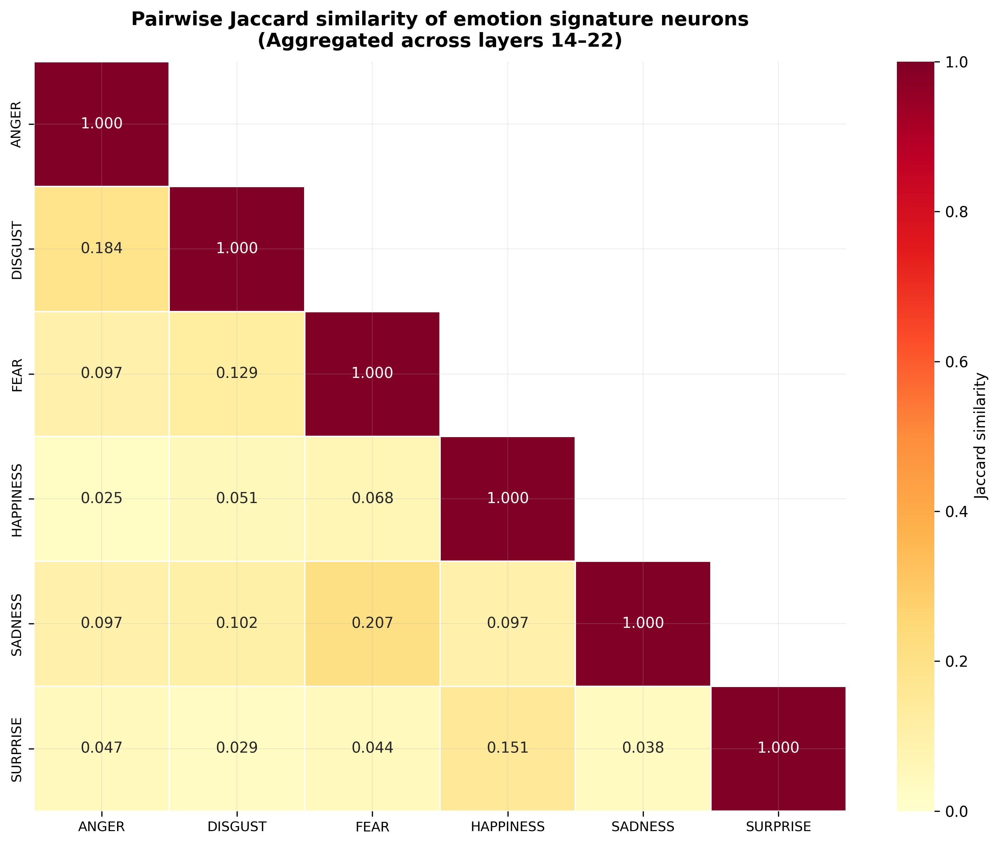
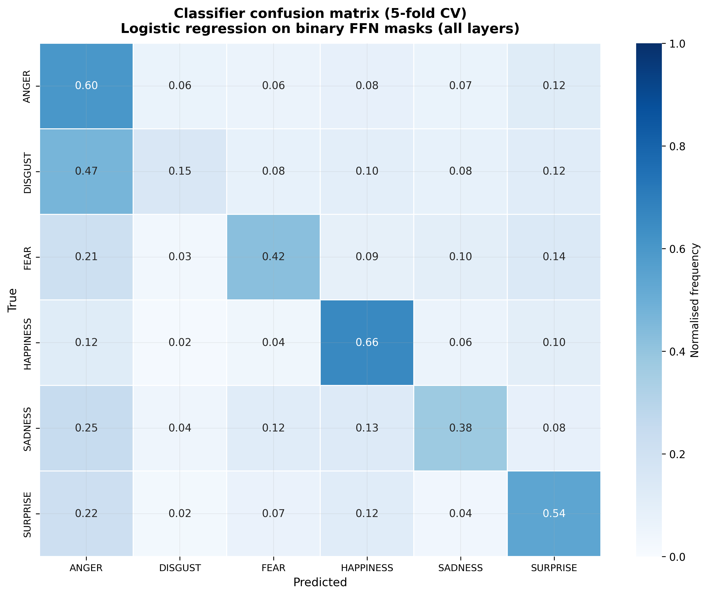

# Emotions at the Gate

**Do large language models have "emotion neurons"?** This project looks inside **Qwen2.5-1.5B-Instruct** while it reads Chinese text labelled with emotions, and asks whether specific neurons in its feed-forward *gates* light up for specific emotions.

The emotions are Paul Ekman's six primaries: **anger, disgust, fear, happiness, sadness and surprise**.

## Research questions

| | Question |
|---|---|
| **RQ1** | When an LLM processes an emotion, is there a specific set of neurons that gets activated? |
| **RQ2** | Is that set the same for each type of primary emotion? |
| **RQ3** | Can we find all such clusters, for every primary emotion? |
| **RQ4** | Do these clusters overlap? |

## Headline results

Results below use the default settings (top 5% of neurons counted as "activated", layers 14–22). Full outputs are in [`emotion_neuron_analysis/results/`](emotion_neuron_analysis/results).

- **RQ1: Consistent neurons exist, but not equally for every emotion.** Each emotion has a set of neurons that fire reliably, growing from about 80 per emotion in layer 14 to over 200 by layer 19. At layer 18, permutation tests find these counts significant for anger, disgust, fear and sadness (p ≤ 0.003), but not for happiness or surprise.
- **RQ2: The patterns carry real emotion information.** A logistic-regression classifier trained only on which neurons were active predicts the emotion with **51.8% accuracy** across six classes (5-fold CV). Happiness (F1 0.63) and anger (0.57) are easiest to tell apart; disgust is hardest (0.19).
- **RQ3: But emotions don't form clean, separate clusters.** On the residual stream, the overall silhouette score is −0.09 and k-NN purity ranges from 0.18 (disgust) to 0.49 (anger). The signal is distributed rather than sitting in neat groups.
- **RQ4: Overlaps follow intuition.** The most similar signature-neuron sets are **fear–sadness** (Jaccard 0.21) and **anger–disgust** (0.18); the least similar are anger–happiness (0.02) and disgust–surprise (0.03). Surprise and happiness have the most neurons exclusive to them.

<p align="center">
  
  
</p>

## Method

1. **Dataset.** About 20,000 Chinese sentences were drawn from a Chinese sentiment dataset and a spoken-dialogue transcription corpus. GLM-4.5 labelled each one with a primary emotion and secondary emotions from the emotion wheel, rows without a valid primary emotion were filtered out, and GLM-4.5 then added an English translation for reference. The final dataset has **16,667 rows**: anger 28.8%, happiness 20.0%, surprise 19.4%, fear 11.4%, sadness 11.2%, disgust 9.3%.
2. **Extraction.** Each Chinese sentence is run through Qwen2.5-1.5B-Instruct. Forward hooks capture the post-SwiGLU **FFN gate activations** (8,960 neurons) and the **residual stream** (1,536 dimensions) in layers 14–22, mean-pooled over tokens and cached as float16 `.npy` files.
3. **RQ1:** per-neuron activation frequency per emotion, chi-square tests and permutation tests (1,000 permutations).
4. **RQ2:** signature neurons via one-sided z-tests (each emotion against all others), split-half reliability (100 repeats), and a logistic-regression classifier on binary activation masks.
5. **RQ3:** UMAP, t-SNE and PCA projections, silhouette scores, k-NN purity and a full table of signature neurons.
6. **RQ4:** pairwise Jaccard similarity, shared versus exclusive neuron counts, hierarchical clustering and an UpSet plot.
7. **Sensitivity:** key metrics re-computed at 1%, 3%, 5% and 10% activation thresholds.

## Repository layout

```
Emotions-at-the-gate/
├── pre_analysis_dataset/          Building the dataset
│   ├── emotion_classifier.py      Label emotions with GLM-4.5
│   ├── filter_empty_emotions.py   Keep rows with valid emotion-wheel labels
│   ├── emotion_summary.py         Label counts → summary.txt
│   ├── translate_chinese.py       Add English translations with GLM-4.5
│   ├── check_translations.py      Find rows missing a translation
│   ├── emotion_neuron_analysis.py First single-script version of the analysis
│   └── *.csv, *.log               Source data, intermediate outputs and logs
└── emotion_neuron_analysis/       The main analysis pipeline
    ├── main.py                    CLI entry point
    ├── config.py                  Model, layers, thresholds, seeds
    ├── preprocessing.py           Load, deduplicate and validate the CSV
    ├── extraction.py              Model hooks and activation caching
    ├── rq1_neuron_frequency.py
    ├── rq2_emotion_specificity.py
    ├── rq3_cluster_enumeration.py
    ├── rq4_overlap_analysis.py
    ├── sensitivity.py
    ├── utils.py
    ├── emotion_dataset_translated.csv
    └── results/                   Plots and summaries for each RQ
```

## Running it

A CUDA GPU is recommended (developed on an RTX 2080 Ti with 11 GB VRAM); Apple MPS and CPU also work. The model (~3 GB) downloads on the first run, and the activation cache needs about 3 GB.

```bash
cd emotion_neuron_analysis
pip install -r requirements.txt --extra-index-url https://download.pytorch.org/whl/cu126

# full pipeline
python main.py --csv emotion_dataset_translated.csv

# reuse cached activations and run only some RQs
python main.py --csv emotion_dataset_translated.csv --skip-extraction --rq 1 3
```

Other flags: `--output-dir`, `--skip-analysis`, `--skip-sensitivity`, `--batch-size`, `--top-k-pct`. See [`emotion_neuron_analysis/README.md`](emotion_neuron_analysis/README.md) for the full output structure.

`requirements.txt` pins CUDA 12.6 builds of PyTorch; on a Mac or CPU-only machine, install `torch` and `torchvision` separately first. The dataset scripts in `pre_analysis_dataset/` need a GLM API key in a `.env` file and only matter if you want to rebuild the dataset.

## Author

Rayan Upadhyay · [rayanupadhyay.com](https://rayanupadhyay.com)
